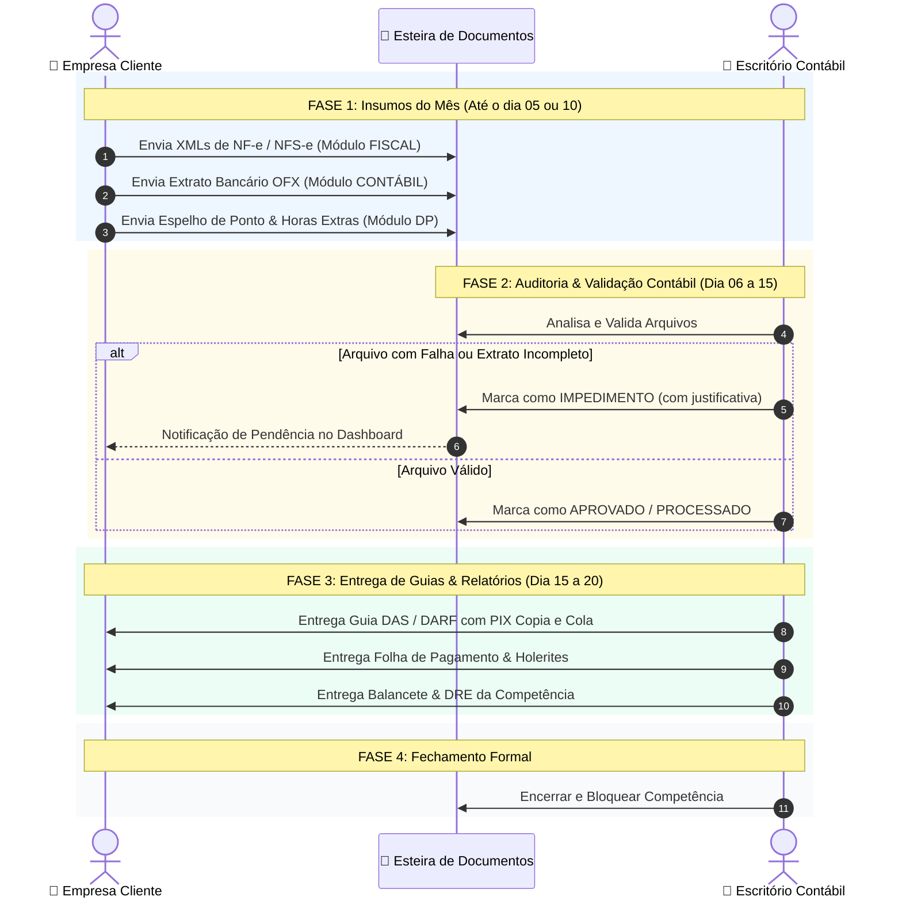

# Arquitetura de Competências Mensais, Módulos Liberados e Esteira de Documentos

> **Documento Oficial de Engenharia & Negócio — TaxSmart Contabilidade**  
> **Versão:** 1.0.0  
> **Status:** Aprovado para Implementação  
> **Público:** Engenharia Front-end/Back-end, Contadores, Analistas e Clientes  

---

## 1. Visão Geral e Princípios Fundamentais

O sistema **TaxSmart Contabilidade** opera no modelo SaaS contábil colaborativo, conectando a **Equipe do Escritório Contábil (Staff)** e os **Empresários/Clientes (Company Users)**.

O núcleo de operação do sistema é orientado a **Competências Mensais (Mês/Ano - ex: 10/2026)**. Em cada competência, ocorre um fluxo bidirecional de troca de informações e obrigações:
1. **O Cliente envia** insumos brutos (XMLs de notas fiscais, extratos bancários em OFX, fechamento de ponto de funcionários e comprovantes de despesas).
2. **O Escritório Contábil processa, apura e entrega** obrigações legais, guias tributárias com código de barras/PIX, relatórios contábeis, folhas de pagamento e holerites.

---

## 2. Tipologia de Usuários, Portes de Empresa e Níveis de Acesso

### 2.1. Classificação por Porte Empresarial (Faturamento Anual)

O porte da empresa determina a complexidade fiscal, os módulos aplicáveis e a volumetria de documentos:

| Porte | Sigla | Faixa de Faturamento Anual | Características e Rotinas no TaxSmart | Módulos Típicos |
|---|:---:|---|---|---|
| **Microempreendedor Individual** | **MEI** | Até R$ 81.000,00 | Regras simplificadas (SIMEI). Guia DAS fixa mensal. Máximo de 1 empregado. Não exige contabilidade complexa. | Fiscal (Básico), Documentos, Atendimento |
| **Microempresa** | **ME** | Até R$ 360.000,00 | Simples Nacional ou Lucro Presumido. Emissão regular de notas (NF-e, NFS-e), folha de sócios (pró-labore) e colaboradores. | Fiscal, Contábil, DP/Folha, Linha do Tempo |
| **Empresa de Pequeno Porte** | **EPP** | R$ 360.000,01 a R$ 4.800.000,00 | Apuração detalhada de faturamento, conciliação de extratos OFX, folha de pagamento estruturada, emissão de guias DAS/DARF/FGTS. | Todos os Módulos (Fiscal, Contábil, DP, RH, Esteira) |
| **Média e Grande Empresa** | **MÉDIA/GRANDE** | Acima de R$ 4.800.000,00 | Lucro Presumido ou Lucro Real. Obrigatoriedade de SPED Fiscal (EFD), EFD-Contribuições, ECD/ECF, conciliação diária de tesouraria. | Todos os Módulos + Auditoria Avançada + BPO Financeiro |

---

### 2.2. Perfis de Usuário no Portal da Empresa (`userType: COMPANY / OWNER`)

| Role | Perfil | Descrição e Permissões |
|---|---|---|
| `COMPANY_ADMIN` / `OWNER` | **Sócio / Diretor / Titular** | Acesso total à empresa. Pode adicionar/editar dados da empresa, cadastrar novos usuários da empresa, aprovar admissões/férias, baixar guias e visualizar relatórios fiscais e contábeis. |
| `COMPANY_FINANCIAL` | **Gestor Financeiro** | Focado nas finanças operacionais. Acesso aos módulos **Fiscal** (DF-e, XMLs, Guias DAS/DARF) e **Contábil** (envio de extratos OFX, recibos de pagamentos e conciliação bancária). |
| `COMPANY_EMPLOYEE` | **Colaborador / RH Interno** | Acesso estrito ao módulo de **DP/RH**. Acesso ao seu espelho de ponto, download de holerites mensais, informe de rendimentos e solicitação de férias/atestados. |

---

### 2.3. Perfis do Escritório Contábil (`userType: STAFF`)

| Role | Perfil | Escopo Padrão | Módulos Extras Liberados |
|---|---|---|---|
| `SUPER_ADMIN` | **Super Administrador** | Irrestrito (todas as empresas e módulos) | Total liberdade para habilitar módulos em `allowedModules`. |
| `ACCOUNTANT` | **Contador Responsável** | Visão geral da carteira, Balanço, DRE, Fechamento de Competência | Todos os módulos operacionais. |
| `FISCAL_ANALYST` | **Analista Fiscal** | Gestão de DF-e, Apuração de Impostos (Simples/Presumido), Emissão de Guias | Apenas `FISCAL` (expansível via `allowedModules`). |
| `PAYROLL_ANALYST` | **Analista de DP/RH** | Folha de pagamento, pró-labore, rescisões, eSocial, FGTS Digital | Apenas `PAYROLL` / `RH` (expansível via `allowedModules`). |

---

## 3. Matriz de Troca de Documentos por Módulo na Competência

Em cada competência mensal (ex: `10/2026`), a esteira de arquivos organiza quem envia e quem entrega:



### 3.1. Detalhamento por Módulo

#### 📌 Módulo Fiscal (`FISCAL`)
- **A Empresa Cliente Envia:**
  - Arquivos XML de NF-e emitidas (saídas de mercadorias).
  - Arquivos XML ou PDF de NF-e de compras e despesas (entradas).
  - Notas de Serviços Tomados (NFS-e de prestadores de fora do município).
  - Relatório de faturamento de maquininhas de cartão / PIX quando não emitido via DF-e.
- **O Escritório Contábil Entrega:**
  - Guia **DAS** (Simples Nacional) com código de barras e PIX Copia e Cola.
  - Guias **DARF** (IRPJ, CSLL, PIS, COFINS) para Lucro Presumido e Real.
  - Recibo de Transmissão do PGDAS-D / DCTF.
  - Relatório consolidado de faturamento mensal e retenções de impostos na fonte.

#### 📌 Módulo Contábil (`ACCOUNTING`)
- **A Empresa Cliente Envia:**
  - Extratos Bancários completos em formato `.OFX` de todas as contas corporativas.
  - Comprovantes de pagamento de boletos, tributos e despesas operacionais.
  - Contratos de empréstimo, financiamento ou aquisição de bens duráveis (veículos, máquinas).
- **O Escritório Contábil Entrega:**
  - Balancete de Verificação mensal.
  - Demonstração do Resultado do Exercício (DRE).
  - Relatório de Conciliação Bancária.
  - Balanço Patrimonial e Livro Razão.

#### 📌 Módulo Departamento Pessoal / Folha (`PAYROLL`)
- **A Empresa Cliente Envia:**
  - Espelho de Ponto mensal consolidado (batidas, horas extras, faltas, adicionais noturnos).
  - Comprovantes de adiantamento salarial ou comissões.
  - Valores informados para pró-labore dos sócios.
- **O Escritório Contábil Entrega:**
  - Folha Analítica de Salários e Pró-Labore.
  - Recibos de Pagamento individuais (**Holerites em PDF**) para cada colaborador.
  - Guia **FGTS Digital** com PIX.
  - Guia **DAE / DCTFWeb** (INSS patronal e retido).

#### 📌 Módulo Recursos Humanos & Trabalhista (`RH`)
- **A Empresa Cliente Envia:**
  - Formulário e documentos para nova admissão (CTPS, RG, comprovante de endereço, ASO).
  - Avisos prévios de demissão e solicitações de rescisão contratual.
  - Solicitação de agendamento de férias de funcionários (com 30 dias de antecedência).
  - Atestados médicos, licenças-maternidade e Comunicação de Acidente de Trabalho (CAT).
- **O Escritório Contábil Entrega:**
  - Contrato de Trabalho e Ficha de Registro de Empregado.
  - Termo de Rescisão do Contrato de Trabalho (TRCT) homologado e guia rescisória do FGTS.
  - Aviso e Recibo de Férias assinado.
  - Recibos de envio de eventos periódicos e não periódicos do **eSocial**.

---

## 4. Arquitetura de Módulos Liberados (`allowedModules`) no Portal do Cliente

### 4.1. Regra de Negócio: Menus e Abas Condicionais
Nem toda empresa contrata o pacote completo de contabilidade. Portanto, os menus laterais e as abas do Portal do Cliente **devem se adaptar dinamicamente** aos módulos contratados:

```typescript
// Exemplo de configuração de módulos liberados no cadastro da Empresa ou Usuário:
company.allowedModules = [
  SystemModule.FISCAL,
  SystemModule.TIMELINE_TASKS,
  SystemModule.ACCOUNTING
  // Note: PAYROLL e RH não contratados para este cliente unipessoal
];
```

### 4.2. Estrutura de Menu Proposta para a Área do Cliente:

1. **Menu Fixo Superior:**
   - Seletor de Empresa Ativa (`Techinova Software (Simples Nacional)`) com dropdown para troca imediata.
   - Botão **`+ Adicionar Nova Empresa`** (permite cadastrar filial ou outro CNPJ sócio).
   - Seletor de Competência Mensal Ativa (`10/2026`).

2. **Menu Lateral Dinâmico:**
   - 📊 **Visão Geral** (`/client/dashboard`) — KPIs de obrigações, guias a pagar e status.
   - ⏱️ **Linha do Tempo** (`/client/timeline`) — Calendário com os dias de vencimento do mês.
   - 📄 **Módulo Fiscal** *(Visível se `allowedModules` contém `FISCAL`)*:
     - *Minhas Guias & DAS* (Guias com PIX)
     - *Notas Fiscais Eletrônicas* (DF-e da competência)
     - *Enviar Arquivos Fiscais* (Upload direto de XML/PDF)
   - 🏦 **Módulo Contábil** *(Visível se `allowedModules` contém `ACCOUNTING`)*:
     - *Extratos & OFX* (Envio e validação)
     - *Balancetes & DRE* (Download de relatórios emitidos)
   - 👥 **Módulo Folha / DP** *(Visível se `allowedModules` contém `PAYROLL`)*:
     - *Holerites dos Colaboradores*
     - *Guias FGTS & DCTFWeb*
     - *Enviar Espelho de Ponto*
   - 🤝 **Módulo Trabalhista (RH)** *(Visível se `allowedModules` contém `RH`)*:
     - *Nova Admissão / Demissão*
     - *Férias & Atestados*
   - 📂 **Central de Documentos** (`/client/documentos`):
     - Visão unificada de todos os arquivos enviados e recebidos no mês.
   - 💬 **Atendimento:**
     - *Falar com o Contador* (Suporte direto / WhatsApp)

---

## 5. Gestão de Múltiplas Empresas (`Multi-Company`) no Cliente

### 5.1. Cenários Reais do Empresário
1. **Sócio com Múltiplos CNPJs:** Um empresário dono de uma empresa de tecnologia (`Techinova`) e sócio de uma empresa de comércio (`Global Retail`). Ele possui apenas 1 login, mas precisa alternar entre as duas empresas facilmente sem deslogar.
2. **Novo Cliente sem Empresa Cadastrada:** Ao se cadastrar, se a conta ainda não tiver vínculo empresarial, o portal exibe o botão destacado **"Cadastrar Minha Primeira Empresa"**, permitindo preencher:
   - Razão Social / Nome Fantasia
   - CNPJ (com consulta automática de dados públicos)
   - Regime Tributário (Simples Nacional, Lucro Presumido, Lucro Real)
   - Porte da Empresa (MEI, ME, EPP, Média/Grande)
   - CNAE Principal

### 5.2. Persistência e Troca de Contexto
- A empresa ativa selecionada é mantida em um Angular Signal global (`companyService.activeCompany`) e persistida no `localStorage` (`taxsmart_client_active_company_id`).
- Todas as requisições HTTP enviam o header `x-company-id: <id>` automaticamente via interceptor, garantindo isolamento total dos dados contábeis e fiscais.

---

## 6. Ciclo de Vida do Fechamento de Competência Mensal

```
   [ Dia 01 a 10 ]               [ Dia 11 a 15 ]                [ Dia 16 a 20 ]               [ Dia 25 a 30 ]
   ───────────────               ───────────────                ───────────────               ───────────────
   RECEBIMENTO                   CONFERÊNCIA                    EMISSÃO DE                    FECHAMENTO E
   DE INSUMOS                    E AUDITORIA                    GUIAS E RELATÓRIOS            ENCERRAMENTO
   • Cliente envia XMLs          • Escritório valida OFX        • Escritório emite DAS        • Competência é
   • Cliente envia OFX           • Conciliação de extratos      • Emissão de DARF/FGTS          formalmente
   • Envio de Ponto/DP           • Cálculo dos impostos         • Envio dos Holerites           fechada
   • Status: ENVIADO             • Status: EM_ANALISE           • Status: APROVADO            • Status: FECHADO
```

### Regras de Encerramento:
1. Quando uma competência atinge o status `FECHADO`, novos envios de documentos para aquela competência são bloqueados.
2. Caso o cliente precise retificar ou enviar um documento retroativo, ele solicita a **Reabertura de Competência**, gerando um log de auditoria no sistema com autorização do `SUPER_ADMIN` ou do `ACCOUNTANT`.

---

## 7. Roadmap de Implementação no Frontend & Backend

1. **Fase 1 (Estrutura de Rotas e Navegação):**
   - Configuração das rotas filhas em `/client` no [app.routes.ts](file:///c:/workspace/workspace_taxsmartcontabilidade/taxsmartfront/src/app/app.routes.ts): `/client/fiscal`, `/client/contabil`, `/client/folha`, `/client/documentos`, `/client/empresas`.
2. **Fase 2 (Menu Lateral Dinâmico):**
   - Refatoração do [cliente-layout.component.html](file:///c:/workspace/workspace_taxsmartcontabilidade/taxsmartfront/src/app/pages/client/cliente-layout/cliente-layout.component.html) para exibir itens condicionados aos `allowedModules` da empresa ativa.
3. **Fase 3 (Seletor Multi-Empresa no Topbar):**
   - Inclusão do dropdown de seleção de empresa com botão `+ Adicionar Empresa` no cabeçalho superior do portal do cliente.
4. **Fase 4 (Tela Unificada de Documentos do Cliente):**
   - Criação da página `/client/documentos`, permitindo ao cliente filtrar por competência e módulo com histórico de aprovação e pendências.
