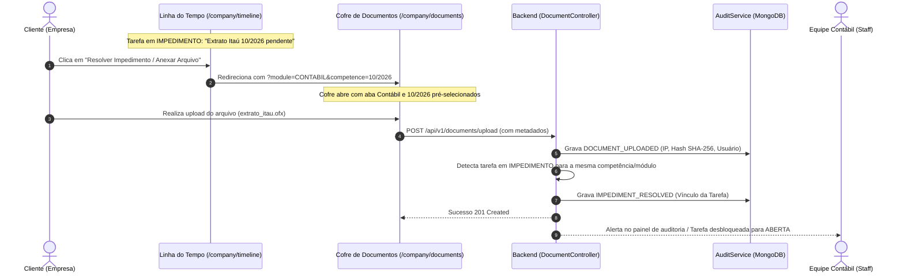

# Arquitetura de Documentos, Linha do Tempo e Segurança — TaxSmart Contabilidade

Este documento detalha as diretrizes de arquitetura, contratos de API, fluxo de auditoria e segurança implementados no ecossistema **TaxSmart Contabilidade** (Backend Node.js/TypeScript e Frontend Angular 18/Ionic 7).

---

## 1. Visão Geral da Arquitetura

O sistema adota uma estrutura em camadas orientada a eventos e responsabilidade única:

```
[ Frontend: Angular 18 + Ionic 7 ]
       │
       ├── TokenInterceptor (Sanitização //, Retry Exponencial 5xx, Refresh 401)
       │
       ├── DocumentVaultComponent (<app-document-vault>)
       │       ├── Inserido em /admin/fiscal (Fiscal & XMLs)
       │       ├── Inserido em /admin/contabil (Contábil & Extratos OFX)
       │       ├── Inserido em /admin/folha (Holerites & Ponto DP)
       │       └── Inserido em /company/documents (Portal da Empresa)
       │
       └── DocumentPreviewModalComponent (<app-document-preview-modal>)
               ├── Visualização de Imagens e PDFs em Iframe
               ├── Download de Arquivos Genéricos (XML, OFX)
               └── Trilha de Eventos e Auditoria em Tempo Real
                       │
                       ▼
[ Backend: Node.js 20+ / Express / TypeScript ]
       │
       ├── DocumentController (/api/v1/documents)
       │       ├── POST   /upload              (Upload com StorageFactory)
       │       ├── GET    /                    (Listagem filtrada por carteira/módulo)
       │       ├── PATCH  /:id/stage           (Transição de estágio & impedimento)
       │       ├── POST   /:id/view            (Auditoria de leitura/visualização)
       │       ├── POST   /:id/download        (Auditoria de download)
       │       ├── GET    /:id/audit           (Histórico completo de auditoria)
       │       ├── DELETE /:id                 (Exclusão auditada e protegida)
       │       └── POST   /close-competence    (Fechamento formal da competência)
       │
       ├── StorageFactory (Local / Google Drive API / Cloudinary)
       │
       └── AuditService (Assíncrono via setImmediate, Sanitização de Segredos)
               │
               ▼
[ Camada de Dados: MongoDB ]
       ├── document_storages (Índices compostos: companyId + competence + module)
       └── audit_logs        (Índices compostos: companyId, module, action, createdAt)
```

---

## 2. Estrutura e Armazenamento Particionado

Para garantir busca ultra-rápida e escalabilidade para centenas de milhares de arquivos ao longo dos anos, os documentos são particionados de forma determinística:

```
taxsmart-storage/
├── [CNPJ_EMPRESA]/                      # Raiz por CNPJ (ex: 12345678000190)
│   ├── [COMPETENCIA]/                   # Competência MM/YYYY (ex: 10/2026)
│   │   ├── FISCAL/                      # Notas Fiscais (NF-e, NFS-e, CT-e), XMLs, Guias (DAS/DARF)
│   │   ├── CONTABIL/                    # Extratos bancários (.OFX), Razão, Balancetes, DRE
│   │   ├── DP/                          # Holerites assinados, Espelhos de ponto, FGTS Digital
│   │   ├── LEGALIZACAO/                 # Contrato Social, Alterações, Alvarás, CNDs
│   │   └── GERAL/                       # Comprovantes e arquivos avulsos
```

### Índices Compostos no MongoDB:
1. `{ companyId: 1, competence: 1, module: 1, createdAt: -1 }`: Busca instantânea nos módulos e competências.
2. `{ companyId: 1, stage: 1 }`: Filtro imediato por pendências ou documentos sob análise.
3. `{ hashSha256: 1 }`: Prevenção de duplicidade e garantia de integridade do arquivo.

---

## 3. Ciclo de Vida e Estágios da Esteira

Cada documento contábil percorre os seguintes estágios controlados:

| Estágio | Descrição | Permissão de Alteração |
| :--- | :--- | :--- |
| `ENVIADO` | Documento postado pelo cliente ou escritório aguardando conferência. | Cliente / Staff |
| `EM_ANALISE` | Analista do escritório iniciou a validação e apuração. | Staff / Super Admin |
| `APROVADO` | Documento validado e aceito para a escrituração ou entrega. | Staff / Super Admin |
| `IMPEDIMENTO` | Apontamento de pendência/erro com justificativa obrigatória. | Staff / Super Admin |
| `PROCESSADO` | Lançado no sistema contábil, apuração concluída ou guia gerada. | Staff / Super Admin |
| `FECHADO` | Competência formalmente encerrada. Bloqueia exclusões e alterações. | Super Admin |

---

## 4. Trilha de Auditoria Completa (`AuditLog`)

Todas as operações críticas, transições de estado e acessos de leitura são auditadas:

| Ação | Nível | Descrição |
| :--- | :--- | :--- |
| `DOCUMENT_UPLOADED` | `INFO` | Upload de novo arquivo com hash SHA-256 e tamanho. |
| `DOCUMENT_VIEWED` | `INFO` | Abertura do documento em tela para leitura/conferência. |
| `DOCUMENT_DOWNLOADED` | `INFO` | Download do arquivo binário pelo usuário. |
| `DOCUMENT_STAGE_CHANGED` | `INFO`/`WARN` | Transição de estágio (ex: de `ENVIADO` para `APROVADO`). |
| `DOCUMENT_IMPEDIMENT` | `WARN` | Bloqueio do documento com justificativa de pendência. |
| `DOCUMENT_DELETED` | `CRITICAL` | Exclusão lógica/física com registro do autor e hash. |
| `COMPETENCE_CLOSED` | `CRITICAL` | Encerramento e bloqueio formal do mês/módulo. |

---

## 5. Camada de Segurança e Interceptor HTTP

O [`jwt.interceptor.ts`](file:///c:/workspace/workspace_taxsmartcontabilidade/taxsmartfront/src/app/interceptors/jwt.interceptor.ts) implementa:
1. **Sanitização de URLs:** Remove barras duplicadas (`//`), prevenindo falhas de roteamento na API.
2. **Injeção do Bearer Token:** Adiciona o cabeçalho `Authorization: Bearer <token>` em todas as requisições autenticadas.
3. **Retry Inteligente com Backoff Exponencial:**
   - Executa até 2 tentativas para falhas transitórias de rede ou erros de servidor (`status >= 500`).
   - Não repete erros de cliente (`4xx`) ou autenticação (`401/403`).
4. **Gerenciamento de Falha de Conexão (Status 0):**
   - Dispara aviso toast automático informando instabilidade ou perda de conexão.
5. **Auto-Logout em Sessão Expirada (401):**
   - Limpa a sessão local e redireciona de forma segura para o login.

---

## 6. Login Híbrido e Consulta de CNPJ

1. **Login Híbrido:**
   - O campo de login aceita tanto o **e-mail tradicional** quanto o **CNPJ da empresa** (com 14 dígitos).
   - Ao receber um CNPJ, o sistema localiza a empresa e autentica com o titular/gestor correspondente (`OWNER` ou `COMPANY_ADMIN`).
2. **Consulta Automática de CNPJ (Estilo ViaCEP):**
   - Endpoint: `GET /api/v1/companies/cnpj-lookup/:cnpj`.
   - Consulta a **BrasilAPI** com fallback resiliente para a **ReceitaWS**.
   - Preenchimento instantâneo de Razão Social, Nome Fantasia, CNAEs, Regime Tributário, Endereço completo e Sócios.

---

## 7. Padronização em Inglês (`english-methods`)

Conforme a skill estabelecida em ambos os repositórios:
- **Código Técnico (100% em Inglês):** Métodos, funções, variáveis, classes, rotas, arquivos e seletores de componentes (`CompanyDocumentsComponent`, `DocumentVaultComponent`, `logViewDocument`, `uploadDocument`, etc.).
- **Textos de Interface e Documentação (pt-BR):** Labels, títulos, botões, mensagens toast e este arquivo explicativo.

---

## 8. Ciclo de Resolução de Impedimentos & Auditoria Bidirecional



1. **Ação Direta no Card de Impedimento:**
   - Na Linha do Tempo (`/company/timeline` e `/admin/timeline`), quando uma tarefa entra em `IMPEDIMENTO`, a caixa de alerta e o botão de ação permitem clique direto: **"Resolver Impedimento / Anexar Arquivo"**.
2. **Deep-Linking e Preservação de Contexto:**
   - A navegação injeta os parâmetros de rota `?module=CONTABIL&competence=10/2026`.
   - O componente destino (`CompanyDocumentsComponent` ou `AdminAccountingComponent`) escuta os `queryParams` e abre automaticamente na aba do módulo correspondente com a competência exata, posicionando o usuário diretamente no local de upload.
3. **Resolução Automática do Impedimento no Backend:**
   - Ao receber o arquivo, o `DocumentController` localiza tarefas bloqueadas (`status: IMPEDIMENTO`) para aquela empresa, competência e categoria.
   - A tarefa é automaticamente destravada para `ABERTA`, com nota no histórico: *"Arquivo 'xxx' anexado pelo cliente em DD/MM/AAAA. Em análise pela equipe contábil."*
   - O `AuditService` gera o log com a ação `IMPEDIMENT_RESOLVED`, garantindo rastreabilidade total para o contador responsável.

