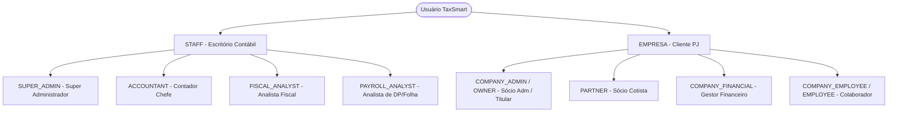

# 👥 Perfis de Usuário, Regras Societárias e Banco de Dados de Testes (Seeds)

> **Documento Oficial de Engenharia & Negócio — TaxSmart Contabilidade**  
> **Versão:** 1.0.0  
> **Data:** Outubro/2026  
> **Público:** Desenvolvedores Front-end/Back-end, Engenharia de Dados, Contadores e QA  

---

## 1. Visão Geral e Princípios Arquiteturais

O ecossistema **TaxSmart Contabilidade** adota uma modelagem rigorosa de permissões, tipos de usuário e regimes tributários, sem tolerância a nomenclaturas legadas (**Zero Retrocompatibilidade**).

Os acessos ao sistema são divididos em dois grandes pilares:
1. **Equipe do Escritório Contábil (`UserType.STAFF`):** Administradores, contadores e analistas que gerenciam a carteira de clientes, executam apurações e cumprem obrigações acessórias.
2. **Usuários da Empresa / Cliente (`UserType.OWNER`, `PARTNER`, `COMPANY_FINANCIAL`, `EMPLOYEE`):** Titulares, sócios cotistas, equipe financeira e colaboradores das empresas atendidas.

---

## 2. Tipologia de Usuários e Perfis (`type` vs `role`)

No modelo de dados `User`, cada conta possui dois campos fundamentais:
- **`type` (UserType):** Identifica a natureza contratual/funcional da pessoa (Ex: `STAFF`, `OWNER`, `PARTNER`, `COMPANY_FINANCIAL`, `EMPLOYEE`).
- **`role` (UserRole):** Define o perfil de autorização e nível de acesso a rotas, formulários e APIs (Ex: `SUPER_ADMIN`, `ACCOUNTANT`, `COMPANY_ADMIN`, `PARTNER`, etc.).



### 2.1. Equipe do Escritório Contábil (`type: STAFF`)

| Role | Perfil | Escopo Padrão | Módulos e Funcionalidades Liberadas |
|---|---|---|---|
| `SUPER_ADMIN` | **Super Administrador** | Irrestrito (Global) | Acesso total a todas as empresas, configurações do escritório, relatórios globais, personalização visual e gestão de usuários. |
| `ACCOUNTANT` | **Contador Chefe** | Toda a Carteira | Gestão contábil completa: Balancete, DRE, Balanço Patrimonial, Livro Diário, conciliação bancária (OFX) e fechamento de competências. |
| `FISCAL_ANALYST`| **Analista Fiscal** | Módulo Fiscal | Importação de DF-e (NF-e, NFS-e, CT-e), apuração do Simples Nacional (PGDAS-D), Lucro Presumido e emissão de guias (DAS, DARF). |
| `PAYROLL_ANALYST`| **Analista de Folha/DP**| Módulo Folha/DP | Gestão de folha mensal, pró-labore de sócios, férias, rescisões, eventos eSocial (S-1200/S-1210) e FGTS Digital. |

---

### 2.2. Usuários da Empresa Cliente

| Type (`type`) | Role (`role`) | Perfil | Descrição e Permissões |
|---|---|---|---|
| `OWNER` | `COMPANY_ADMIN` | **Sócio Administrador / Titular** | Administrador legal da empresa. Permissão total de gestão da empresa: adiciona/remove usuários, altera dados cadastrais, aprova folha, visualiza impostos e baixa guias. |
| `OWNER` | `OWNER` | **Titular Único (MEI)** | Proprietário individual de Microempreendedor Individual. Gerencia guias DAS-MEI e faturamento simplificado. |
| `PARTNER` | `PARTNER` | **Sócio Cotista** | Sócio da empresa com participação societária, porém **sem poderes administrativos operacionais**. Visualiza demonstrativos, DRE, informes de rendimentos e faturamento. |
| `COMPANY_FINANCIAL`| `COMPANY_FINANCIAL`| **Gestor Financeiro** | Acesso operacional aos módulos **Fiscal** (DF-e, notas, guias DAS/DARF) e **Contábil** (extratos bancários OFX, comprovantes e conciliação). Não gerencia dados societários ou RH. |
| `EMPLOYEE` | `COMPANY_EMPLOYEE` | **Colaborador / Funcionário** | Acesso estrito ao portal do colaborador: download de holerites mensais, informe de rendimentos (IRRF) e envio de atestados/solicitações. |

---

## 3. Regras Societárias por Regime Tributário

O sistema implementa regras estritas de integridade societária de acordo com o regime tributário da empresa (`Company.taxRegime`):

### 3.1. Microempreendedor Individual (`TaxRegime.MEI`)
- **Regra:** O MEI é uma empresa de natureza individual unipessoal (titular único).
- **Restrição:** É **terminantemente proibido** cadastrar sócios do tipo `PARTNER` em empresas enquadradas como `MEI`.
- **Validação no Backend (`companyUser.controller.ts`):**
  ```typescript
  if (company.taxRegime === TaxRegime.MEI && (role === UserRole.PARTNER || type === UserType.PARTNER)) {
    return res.status(422).json({
      success: false,
      error: {
        code: 'MEI_CANNOT_HAVE_PARTNERS',
        message: 'Empresas enquadradas no MEI não admitem sócios cotistas (PARTNER).',
      },
    });
  }
  ```
- **Comportamento no Frontend (`AdminCompanyUsersComponent`):**
  - O seletor de perfil detecta dinamicamente se a empresa selecionada é MEI.
  - A opção `PARTNER (Sócio Cotista)` é ocultada/desabilitada, exibindo um alerta explicativo ao usuário.

### 3.2. Sociedades LTDA, EIRELI e S/A (`SIMPLES_NACIONAL`, `LUCRO_PRESUMIDO`, `LUCRO_REAL`)
- Admitem quadro societário composto por:
  - 1 ou mais Sócios Administradores (`COMPANY_ADMIN` / `OWNER`).
  - 1 ou mais Sócios Cotistas (`PARTNER`).
  - Operadores Financeiros (`COMPANY_FINANCIAL`).
  - Colaboradores e Funcionários Registrados (`COMPANY_EMPLOYEE`).

---

## 4. Estrutura do Banco de Dados Semeado (Seeds)

Ao executar os scripts de povoamento, o banco de dados é inicializado com **3 empresas representativas** de diferentes regimes tributários e portes, além de 10 tarefas e obrigações mensais.

### 4.1. Empresas de Demonstração

1. **TechInova Soluções Digitais Ltda:**
   - **Regime:** `SIMPLES_NACIONAL` (Anexo III - Fator R de 29,1%).
   - **Atividade:** Desenvolvimento de Software e Consultoria em TI.
   - **Quadro Societário:**
     - Carlos Eduardo Silva (70% - Sócio Administrador)
     - Mariana Souza Santos (30% - Sócia Cotista)
   - **Documentos:** 2 Notas Fiscais de Serviços (NFS-e de R$ 25.000 e R$ 18.000 = Faturamento R$ 43.000/mês).
   - **Guia Emitida:** Guia DAS Simples Nacional (R$ 2.580,00) com código de barras e chave PIX Copia e Cola.

2. **Vanguarda Logística & Transportes Eireli/Ltda:**
   - **Regime:** `LUCRO_PRESUMIDO`.
   - **Atividade:** Transporte rodoviário interestadual de cargas e insumos farmacêuticos.
   - **Quadro Societário:**
     - Fernanda Oliveira Lima (100% - Titular Administradora)
   - **Documentos:** Conhecimento de Transporte Eletrônico (CT-e de R$ 62.000).
   - **Guia Emitida:** DARF PIS/COFINS Cumulativo (R$ 2.263,00).

3. **Studio Alfa Fotografia:**
   - **Regime:** `MEI` (Microempreendedor Individual).
   - **Atividade:** Produção fotográfica e edição digital.
   - **Quadro Societário:**
     - Lucas Alfa Fotógrafo (100% - Titular Único `OWNER`).
   - **Documentos:** 1 Nota de Serviço (NFS-e de R$ 3.500).
   - **Guia Emitida:** DAS-MEI mensal fixa (R$ 75,00).

---

## 5. Tabela Completa de Credenciais de Acesso de Teste

> 🔐 **Senha Padrão Unificada:** `Smart@25`

### 5.1. Escritório Contábil (Equipe Interna)

| Perfil | Nome | E-mail de Login | Senha |
|---|---|---|---|
| **Super Administrador** | Super Admin TaxSmart | `admin@taxsmart.com.br` | `Smart@25` |
| **Contador Chefe** | Roberto Contabilidade | `contador@taxsmart.com.br` | `Smart@25` |
| **Analista Fiscal** | Juliana Especialista Fiscal | `fiscal@taxsmart.com.br` | `Smart@25` |
| **Analista de DP/RH** | Marcos Departamento Pessoal | `folha@taxsmart.com.br` | `Smart@25` |

### 5.2. Empresa 1: TechInova Soluções Digitais (Simples Nacional)

| Perfil / Papel | Nome | E-mail de Login | Senha |
|---|---|---|---|
| **Sócio Administrador (`COMPANY_ADMIN`)** | Carlos Eduardo (TechInova) | `carlos@techinova.com.br` | `Smart@25` |
| **Sócia Cotista (`PARTNER`)** | Mariana Souza (Sócio TechInova) | `mariana@techinova.com.br` | `Smart@25` |
| **Gestor Financeiro (`COMPANY_FINANCIAL`)** | Beatriz Financeiro (TechInova) | `financeiro@techinova.com.br` | `Smart@25` |
| **Colaborador (`COMPANY_EMPLOYEE`)** | Lucas Desenvolvedor | `colaborador@techinova.com.br` | `Smart@25` |

### 5.3. Empresa 2: Vanguarda Express (Lucro Presumido)

| Perfil / Papel | Nome | E-mail de Login | Senha |
|---|---|---|---|
| **Titular Administradora (`COMPANY_ADMIN`)** | Fernanda Oliveira (Vanguarda) | `fernanda@vanguardaexpress.com.br` | `Smart@25` |
| **Gestor Financeiro (`COMPANY_FINANCIAL`)** | Roberto Tesouraria (Vanguarda) | `financeiro@vanguardaexpress.com.br` | `Smart@25` |
| **Colaborador / Motorista (`COMPANY_EMPLOYEE`)**| Marcos Motorista | `motorista@vanguardaexpress.com.br` | `Smart@25` |

### 5.4. Empresa 3: Studio Alfa Fotografia (MEI)

| Perfil / Papel | Nome | E-mail de Login | Senha |
|---|---|---|---|
| **Titular Único (`OWNER`)** | Lucas Alfa Fotógrafo | `lucas@studioalfa.com.br` | `Smart@25` |

---

## 6. Comandos para Execução e Testes

No terminal do backend (`taxsmartback`):

```powershell
# 1. Executar o Seed completo em ambiente de Desenvolvimento (banco taxsmart_dev)
npm run seed

# 2. Executar o Seed completo em ambiente de Produção (banco taxsmart_prod)
npm run seed:prod

# 3. Inicializar apenas estrutura base (sem tarefas ou notas fictícias)
npm run init:db
npm run init:db:prod

# 4. Limpar todas as coleções
npm run clear:db

# 5. Checagem de tipagem TypeScript
npx tsc --noEmit
```

---

## 7. Notas Técnicas sobre Builds de Produção do Frontend

Ao rodar comandos como `ionic serve --configuration=production` ou `ionic build --configuration=production`, é comum o compilador exibir mensagens como:
```text
:host-context([dir=rtl]) .ion-float-lg-start -> Unknown pseudo-class :host-context([object Object])
.ion-float-lg-start:dir(rtl) -> Unknown pseudo-class :dir
```
- **Causa:** Otimizador de CSS do Angular (`lightningcss` / `postcss`) analisando utilitários nativos de suporte a escrita da direita para a esquerda (RTL - árabe/hebraico) fornecidos no bundle do Ionic.
- **Impacto:** **Nenhum**. Trata-se de um aviso estético do parser de otimização CSS. A aplicação funciona normalmente com total compatibilidade nos navegadores e dispositivos Android/iOS.
